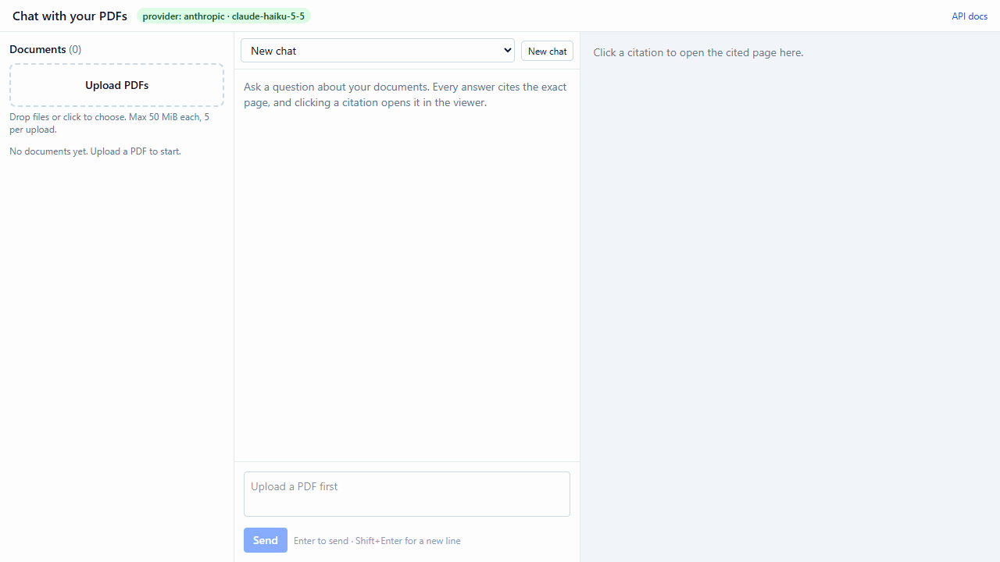
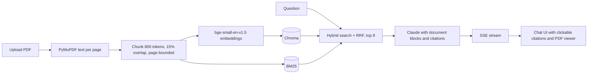

# pdf-chat-rag

[](https://github.com/jumilandelapena/pdf-chat-rag/actions/workflows/ci.yml)


**Upload PDFs, ask questions, and get streamed answers whose every claim links to the exact page it came from.** Retrieval is hybrid (vector + BM25 fused with reciprocal rank fusion), answers come from Claude with native citations, and clicking a citation opens the page in an embedded viewer with the quoted passage highlighted. Everything runs with one `docker compose up`, and the same stack runs with a mock provider when there is no API key.



*Real run of `npm run demo:gif -- --clean --base-url http://localhost:5173` with `LLM_PROVIDER=anthropic` (claude-haiku-5-5) against the RFC 2324 sample.*

## Pipeline



## How it works

1. **Ingest.** Each upload is validated (magic bytes, 50 MiB, 5 files per request), stored, and processed in the background: PyMuPDF extracts text per page, the chunker packs sentences into chunks of at most 800 bge tokens with 15% overlap that never cross a page, and every chunk is embedded locally with `BAAI/bge-small-en-v1.5` and written to Chroma. Documents move from `processing` to `ready` (or `failed` with a reason).
2. **Retrieve.** A question is embedded, the 20 nearest chunks are fetched from Chroma, the 20 best BM25 matches are fetched from an index built over the chat's documents, and the two lists are fused with reciprocal rank fusion. The top 8 chunks go to the model. On follow-up questions a cheap Haiku call first rewrites the question into a standalone search query.
3. **Answer with citations.** Each chunk is sent as a `document` block titled `<file> - page <N>` with citations enabled. Claude's `char_location` citations are mapped back to the chunk, page and quoted text, and to UTF-16 offsets in the answer.
4. **Stream.** The endpoint is Server-Sent Events: `status`, `token`, `citations`, `usage` (tokens, cache hits, cost) and `done`, or `error`. Nothing is persisted when a stream ends in an error, so a retry never duplicates a turn.
5. **View.** The UI places numbered chips in the answer; a click opens the cited page in react-pdf and wraps the quote in a highlight inside the text layer.

## Quick start

With an Anthropic API key:

```bash
git clone https://github.com/jumilandelapena/pdf-chat-rag.git && cd pdf-chat-rag
cp .env.example .env          # set LLM_PROVIDER=anthropic and paste ANTHROPIC_API_KEY
docker compose up --build     # UI at http://localhost:8080, API docs at http://localhost:8080/docs
```

Without a key the same stack runs the mock provider: skip the `.env` step (or set `LLM_PROVIDER=mock`). Uploads, retrieval, streaming and the viewer are real; only the answer text is canned, and its citations still point at the retrieved passages.

Development mode (two terminals, needs [uv](https://docs.astral.sh/uv/) and Node 24):

```bash
cd backend && uv sync && uv run uvicorn app.main:app --reload --reload-dir app --port 8000
cd frontend && npm install && npm run dev      # http://localhost:5173, /api is proxied to :8000
```

The first local run downloads the embedding model (about 130 MB) into the Hugging Face cache. On Windows, use `uv run` for everything (the Store `python` stub does not work), keep `DATA_DIR` outside OneDrive or Dropbox folders, and make sure the Visual C++ runtime is installed (Chroma needs it).

## Eval results

Measured with `uv run evals/run.py` on the 20-question golden set in `backend/evals/golden.jsonl` (7 questions on a NASA fact sheet, 7 on RFC 2324, 6 on "The Yellow Wallpaper"), answer, rewrite and judge model `claude-haiku-5-5`, local bge embeddings. Full tables: [docs/eval-results.md](docs/eval-results.md).

| Metric | Value |
| --- | --- |
| Recall@8 (expected page among the retrieved chunks) | 100% |
| Answers with at least one citation | 100% |
| Citation accuracy: any cited page correct / all cited pages correct | 100% / 80% |
| Faithfulness (1 to 5, Haiku judge) | 5.00 |
| `max_tokens` stops | 0 |
| Latency median / p95 | 1.3 s / 2.1 s |
| Mean cost per question | $0.0010 |

Prompt caching on follow-up turns (the earlier turn's document blocks are re-sent byte-identically):

| Follow-up | Cache read tokens | Cache write tokens | Cost turn 1 / turn 2 |
| --- | --- | --- | --- |
| NASA crawler weight, then "How many pickup trucks is that?" | 7,955 | 6,903 | $0.0001 / $0.0011 |
| RFC teapot error, then "Which section defines that code?" | 10,580 | 8,418 | $0.0012 / $0.0012 |
| Yellow Wallpaper physician, then "Does he believe she is sick?" | 11,409 | 10,424 | $0.0013 / $0.0016 |

The faithfulness score is a consistency check, not an independent audit: with the default configuration Haiku judges Haiku. Switch `JUDGE_MODEL=claude-opus-5-5` for a stronger judge.

## API

| Method and path | Purpose |
| --- | --- |
| `POST /documents` | Upload up to 5 PDFs (multipart field `files`), returns the rows in `processing` state |
| `GET /documents`, `DELETE /documents/{id}` | List, delete (vectors, index, rows and file) |
| `GET /documents/{id}/file` | Serve the PDF inline with Range support (used by the viewer) |
| `POST /chats`, `GET /chats`, `GET /chats/{id}` | Create (`document_ids: []` means every ready document), list, read with messages |
| `PATCH /chats/{id}`, `DELETE /chats/{id}` | Change the document scope or title, delete |
| `POST /chats/{id}/messages` | Ask a question; answers as an SSE stream (`status`, `token`, `citations`, `usage`, `done`, `error`) |
| `GET /health`, `GET /docs` | Health probe with the active provider, interactive OpenAPI docs |

The SSE event shapes and the citation mapping are described in [docs/architecture.md](docs/architecture.md).

## Tests

- **Backend (pytest, 60 cases):** settings, PDF extraction, chunk invariants (offsets, token and character caps, overlap, page boundaries), embeddings, BM25, RRF, hybrid retrieval, prompt builder (block order and cache breakpoints), citation mapping (UTF-16 offsets), pricing, the mock provider, the documents and chats APIs including the SSE event order and persistence, stop reasons, golden anchors, and an offline eval smoke run. Runs without a key or network.
- **Frontend (Vitest, 44 cases):** the SSE parser (CRLF across chunks, comments, multibyte splits, silence watchdog), chip placement, quote matching in the text layer, cost formatting, the API client, the streaming hook, and the chat, viewer, documents and app components with react-pdf stubbed.
- **End to end (Playwright):** upload the RFC sample, wait for `ready`, ask the teapot question, check the streamed mock answer and cost line, click the first chip, assert the viewer shows the cited page with a highlighted quote, reload and find the history; plus a 375 px run that checks the panels stack.

```bash
cd backend && uv run pytest
cd frontend && npm test && npm run test:e2e        # e2e spawns uvicorn (mock) and Vite itself
```

## CI

| Job | Trigger | What it proves |
| --- | --- | --- |
| backend | push, PR | `ruff`, `pytest`, and `evals/run.py --provider mock --embeddings fake --limit 3` on Ubuntu with the fake embedder |
| frontend | push, PR | `tsc -b`, Vitest, production build |
| e2e | push, PR | Builds both Docker images, starts the compose stack with the mock provider, runs the Playwright smoke test through nginx, uploads the trace on failure |

## Design decisions

- **Hybrid retrieval.** Vector search alone misses exact tokens such as `418` or `Accept-Additions`; BM25 alone misses paraphrases. Fusing both with RRF costs nothing at this scale and the eval shows 100% recall@8 on the golden set. The BM25 index uses the Lucene idf formula because the classic Okapi idf goes to zero on a corpus of ten chunks.
- **Native citations instead of citations in prose.** Asking the model to write `[page 3]` gives unverifiable text. The citations API returns the exact quoted characters of a block the server sent, so every chip is checked against real text and the viewer can highlight it.
- **Local embeddings.** `bge-small-en-v1.5` runs on CPU in milliseconds per chunk, costs nothing per query, and is baked into the Docker image so the container needs no network access for ingestion.
- **Prompt caching and history re-sending.** The system prompt and the last document block carry cache breakpoints, and past turns are re-sent with their original document blocks, so a follow-up reads the earlier documents from the cache (7,955 to 11,409 cached tokens per follow-up in the eval).
- **Cost.** A question costs about $0.001 with Haiku 5.5 (roughly 10,000 prompt tokens, half of them often served from the cache, and about 130 output tokens). The same request on Opus 5.5 costs about 40 times more; `ANSWER_MODEL=claude-opus-5-5` is the only change needed.
- **800-token chunks with a 512-token embedder.** Chunks are sized for the answer model; the embedder sees each chunk as the normalised mean of its sub-window embeddings, which keeps one vector per chunk without truncating text.
- **Mock provider in CI.** The e2e job and the eval smoke run never need a key. The mock quotes real sentences from the retrieved chunks, so citation chips and highlights are exercised for real.
- **Refusals and truncation are surfaced, not hidden.** `max_tokens`, `refusal` and context-window stops become `error` events and nothing is stored.

Choices made where the brief left room:

- Chunk size is counted in bge WordPiece tokens, with an additional 4,800-character cap for pathological text.
- Limits: 50 MiB per file, 5 files per request; the nginx and FastAPI body limits match.
- Extra endpoints and events beyond the brief: `status` SSE events, `PATCH` and `DELETE /chats/{id}`, `GET /health`.
- An empty `document_ids` list means "all ready documents", so new uploads join existing chats automatically.
- Answers are plain text (no Markdown), which keeps citation offsets exact.
- The viewer highlight matches quotes after folding whitespace, quotes, dashes and ligatures, because PDF text layers rarely match byte for byte.
- Chroma runs in a single process; the server runs one worker.
- Haiku 5.5 is the default for answers, rewrite and judge to keep a demo nearly free; Opus is one environment variable away.
- The classic text is "The Yellow Wallpaper" (public domain), rendered to PDF locally; see `sample-pdfs/README.md` for all three sample licences.
- PyMuPDF is AGPL-3.0; this repository stays MIT and publishes its full source, see `NOTICE`.

## Limitations and roadmap

- Scanned PDFs have no text layer and fail with a clear message; OCR is not wired in.
- No reranker between RRF and the model; a cross-encoder would help on larger collections.
- Single user, no authentication, local disk storage; the Docker image is about 2 GB because of torch.
- Render's free tier is tight on memory for torch and loses data on restart; see [docs/deploy.md](docs/deploy.md).
- pdf.js 5 needs a modern browser (`Promise.withResolvers`).

## Deploy

`render.yaml` deploys the API to Render and `frontend/vercel.json` serves the UI from Vercel; [docs/deploy.md](docs/deploy.md) walks through both, including the honest free-tier caveats.

## Project layout

```
backend/        FastAPI app (app/), evals/, scripts/, tests/, Dockerfile
frontend/       React + Vite app (src/), e2e/ Playwright, scripts/demo-gif.ts, Dockerfile, nginx.conf
sample-pdfs/    three public documents used by the demo, tests and evals
docs/           architecture.md, deploy.md, eval-results.md, demo.gif
.github/        CI workflow (backend, frontend, e2e)
docker-compose.yml, render.yaml, .env.example
```

## License

MIT for the code in this repository (see `LICENSE`). PyMuPDF is licensed under the AGPL-3.0; a combined distribution or network deployment of this app is governed by that licence, see `NOTICE`.
