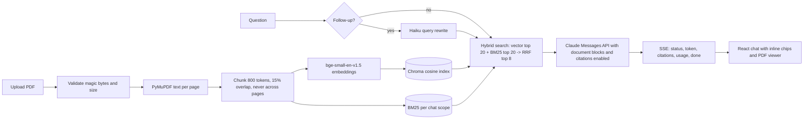

# Architecture

pdf-chat-rag is a small retrieval-augmented generation service: PDFs are split into page-bounded chunks, searched with a hybrid of vector similarity and BM25, and answered by Claude with native citations that the UI turns into clickable page references. This document describes the moving parts; the README covers how to run it.

## Pipeline



## Request sequence

```mermaid
sequenceDiagram
    autonumber
    participant UI as React UI
    participant API as FastAPI
    participant RW as Haiku (rewrite)
    participant IDX as Chroma + BM25
    participant LLM as Claude (answer)
    UI->>API: POST /chats/{id}/messages {content}
    API->>API: load history (past turns with their chunk ids)
    alt follow-up turn
        API-->>UI: status rewriting
        API->>RW: rewrite question with the conversation
        RW-->>API: standalone query
    end
    API-->>UI: status retrieving
    API->>IDX: embed query, vector top 20, BM25 top 20, RRF
    IDX-->>API: 8 chunks
    API-->>UI: status thinking
    API->>LLM: system prompt + history turns + 8 document blocks + question (streamed)
    LLM-->>API: text_delta events
    API-->>UI: token events
    LLM-->>API: final message with char_location citations
    API->>API: map citations to chunks, pages and answer offsets; persist both turns
    API-->>UI: citations, usage, done
    UI->>UI: chip click opens the page and highlights the quote
```

## Modules

| Area | Files | Responsibility |
| --- | --- | --- |
| Settings | `backend/app/config.py` | Pydantic settings; reads the repo-root `.env` then `backend/.env`; fails fast when the Anthropic provider has no key |
| Persistence | `backend/app/db/{engine,models,repo}.py` | SQLite (WAL) via SQLAlchemy 2.0; thin repository functions |
| Ingestion | `backend/app/ingest/{pdf,tokens,chunker,embeddings,pipeline}.py` | PyMuPDF extraction, bge WordPiece token counting, page-bounded chunking, embeddings, the background job and deletion |
| Retrieval | `backend/app/retrieval/{vector_store,bm25,rrf,hybrid}.py` | Chroma wrapper, per-scope BM25 registry, reciprocal rank fusion, the `retrieve()` entry point |
| LLM | `backend/app/llm/{prompts,anthropic_provider,mock_provider,rewrite,citations,pricing}.py` | Frozen prompts and the pure request builder, the streaming Anthropic provider, the offline mock, rewrite helpers, citation mapping, cost estimates |
| HTTP | `backend/app/api/{documents,chats,schemas}.py`, `backend/app/main.py` | Routers, SSE endpoint, body-limit middleware, lifespan |
| Evals | `backend/evals/{golden.jsonl,check_golden.py,judge.py,run.py}` | 20 golden questions with page anchors, the runner that writes `docs/eval-results.md` |
| Frontend | `frontend/src/lib/{sse,citations,quote,format}.ts`, `hooks/useChatStream.ts`, `components/{documents,chat,viewer}` | SSE parser with a silence watchdog, chip placement, quote matching in the pdf.js text layer, the streaming state machine |

Three process-wide re-entrant locks serialise the parts that are not thread-safe: `INGEST_LOCK` (PyMuPDF, one ingestion at a time), `MODEL_LOCK` (every embedding call) and `INDEX_LOCK` (every Chroma or BM25 call and the status commits).

## Data model

| Table | Columns | Notes |
| --- | --- | --- |
| `documents` | id, filename, stored_path, size_bytes, status, error, page_count, chunk_count, scanned_pages, timestamps | status is `processing`, `ready` or `failed` |
| `pages` | document_id, page_number (1-based), text, char_count, is_scanned | the exact text the chunk offsets index into |
| `chunks` | id (`<document>:<index>`), document_id, page_number, chunk_index, char_start, char_end, text, token_count | `text == page.text[char_start:char_end]` always holds |
| `chats` | id, title, timestamps | title is set from the first question |
| `chat_documents` | chat_id, document_id, position | explicit scope; no rows means every ready document |
| `messages` | id, chat_id, seq, role, content, chunk_ids (JSON), rewritten_query, citations (JSON), usage (JSON), model | user rows keep the chunk ids that were sent as document blocks |

The schema is created with `create_all` at startup; there are no migrations yet.

## Chunking and embeddings

Pages are split into sentence units, then packed greedily to at most 800 bge WordPiece tokens and 4,800 characters. Consecutive chunks on a page overlap by whole sentences adding up to at most 120 tokens (15%). Chunks never cross a page, so every citation maps to exactly one page. The embedding model accepts 512 tokens; a chunk longer than 480 tokens is embedded as the normalised mean of its sub-window embeddings. Queries get the bge instruction prefix.

## Retrieval

Vector search returns the 20 nearest chunks within the chat scope (cosine, Chroma). BM25 searches the same scope with a per-scope index whose idf uses the Lucene formula, so it stays positive on tiny corpora. Both lists are fused with reciprocal rank fusion (`k = 60`), and the top 8 chunks are sent to the model. On follow-up turns a Haiku call rewrites the question into a standalone query that is used for retrieval only; the model still sees the original question.

## SSE protocol

`POST /chats/{id}/messages` answers with `text/event-stream`. Every `data` field is JSON.

| Event | Payload | When |
| --- | --- | --- |
| `status` | `{"stage": "rewriting" or "retrieving" or "thinking"}` | progress before the first token |
| `token` | `{"text": "..."}` | one text delta from the model |
| `citations` | list of `{n, document_id, filename, page, quote, text_start, text_end, chunk_id, page_char_start, page_char_end}` | once, after the final message |
| `usage` | `{input_tokens, output_tokens, cache_read_input_tokens, cache_creation_input_tokens, thinking_tokens, model, cost_usd}` | once |
| `done` | `{message_id, user_message_id, rewritten_query}` | end of a successful answer |
| `error` | `{code, message}` with codes `no_documents`, `no_results`, `provider_error`, `max_tokens`, `refusal`, `context_window` | the stream ends here and nothing is persisted |

An idle stream carries a `: ping` comment every 15 seconds; the frontend drops the connection after 60 seconds without any bytes.

## Citation mapping

Each retrieved chunk becomes one `document` block with `citations: {enabled: true}` and the title `<filename> - page <N>`. The model answers with text blocks that carry `char_location` citations: a `document_index` over every document block in the request (history turns included, in order) and character offsets into that block's text. The backend keeps a flat list of the blocks it sent, so `document_index` resolves to a chunk, and `page_char_start = chunk.char_start + start_char_index` locates the quote in the stored page text. Citation numbers are assigned by first appearance and de-duplicated on the quoted text. The answer offsets `text_start`/`text_end` are UTF-16 code units, which are plain JavaScript string indices; the frontend places a chip at `text_end` of each cited block. In the viewer the quote is matched against the pdf.js text layer after folding whitespace, quotes, dashes and ligatures, and every matching span is wrapped in a `<mark>`.

## Prompt caching

The request puts `cache_control` breakpoints on the system prompt and on the last document block of the current turn. Past turns are re-sent byte-identically, including their original document blocks (rebuilt from the stored chunk ids), so the prefix stays stable and the follow-up turn reads the earlier documents from the cache instead of paying for them again. The eval runner reports `cache_creation_input_tokens` on the first turn and `cache_read_input_tokens` on the follow-up; see `docs/eval-results.md`.

## Cost

Each question sends roughly 6,000 to 8,000 prompt tokens (eight chunks of up to 800 tokens plus the system prompt) and produces a short answer. With Haiku 5.5 ($0.10 per million input tokens, $0.50 per million output tokens) that is well under a cent per question; the measured mean is in `docs/eval-results.md`. Switching `ANSWER_MODEL` to `claude-opus-5-5` multiplies the price by about 40. Rewrite and judge calls run on Haiku with thinking disabled.

## Safety and limits

Uploads must carry a `.pdf` name, a PDF content type and the `%PDF-` magic bytes; each file is capped at 50 MiB and each request at 5 files, enforced again by a body-limit middleware and by nginx in Docker. Refusals and truncated answers are surfaced as `error` events and never stored. Chroma runs in a single process, so the backend must run with one worker. The Docker image runs as a non-root user with the model baked in and no network access needed at runtime except to the Anthropic API.

## Extending

A cross-encoder reranker between RRF and the model, OCR for scanned pages, per-user authentication and object storage for uploads are the natural next steps; each touches one module listed above.
